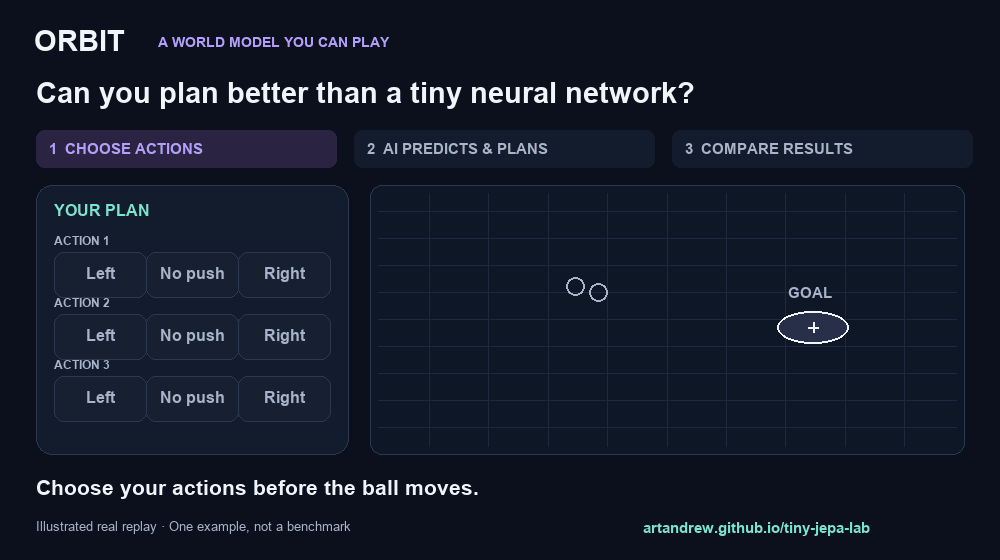

# ORBIT — a world model you can play

**Can you guide a ball to the target better than a tiny neural network?**

[**Play now →**](https://artandrew.github.io/tiny-jepa-lab/) · [Играть по-русски](https://artandrew.github.io/tiny-jepa-lab/ru/) · [中文体验](https://artandrew.github.io/tiny-jepa-lab/zh/)

English · [Русский](README.ru.md) · [简体中文](README.zh-CN.md)

ORBIT is an **educational world-model demo presented as a browser game**. A small, pretrained, JEPA-inspired neural network predicts the effects of actions and uses those predictions to plan. Choose three actions and compare your result with its plan.

[](https://artandrew.github.io/tiny-jepa-lab/)

*Illustrated replay generated from the actual game rules and trained model. One example round, not a benchmark or a screen recording.*

## What is a world model?

A world model learns from observations to predict how its environment will change. When those predictions account for actions, it can help answer **“What happens if I do this?”** before choosing a plan.

In ORBIT, the “world” is deliberately small: **a ball, walls, and a target**.

1. **Observe:** turn two images of the moving ball into compact numerical features.
2. **Predict:** estimate the effects of 27 possible three-action plans in feature space.
3. **Choose and test:** select the plan closest to the goal image, then let the simulator reveal what actually happens.

The predictor does not generate future video frames. Its forecast can be wrong — seeing those mistakes is part of the demo. This is an independent educational implementation inspired by JEPA, with its own trained weights and a narrow task; it does not run Meta's V-JEPA model.

<!-- glass-example:start -->
## LLMs and JEPA: a simple example with a glass

Imagine a glass of water at the edge of a table. What happens if you push it over the edge? This example helps explain what different models are trained to do.

<table>
<tr>
<td width="220"></td>
<td><strong>An LLM explains in words</strong><p>Given a description of the situation, a language model might answer: “The glass will fall, the water will spill, and the glass may break.”</p><p>It draws on patterns learned from text and other training data. A multimodal model can also take an image of the scene as input.</p></td>
</tr>
<tr>
<td width="220"></td>
<td><strong>JEPA predicts a representation of the scene</strong><p>From observations, such a model learns to predict hidden or future information as numerical features — an internal description of the scene.</p><p>If the model is additionally trained to account for actions, its predictions can help evaluate the effects of different pushes before executing them.</p></td>
</tr>
</table>

*The photos illustrate the glass example. They are not predictions from ORBIT, which was trained only on ball motion.*

**The key distinction here is the training objective.**

- During pretraining, many LLMs primarily learn to predict the next token: a word or part of a word.
- JEPA learns to predict a latent representation of missing information; in dynamics models, this can include a future state.

An LLM can also give a correct explanation and, with enough initial information, help calculate a trajectory. JEPA alone is not a complete agent: it is an approach to learning predictive representations that can support world models and planning systems.

ORBIT demonstrates this idea with a ball: the model observes two frames, predicts the effects of 27 plans, and picks one. The simulator then reveals whether it got closer to the goal.

Primary sources: [I-JEPA: predicting representations](https://ai.meta.com/blog/yann-lecun-ai-model-i-jepa/) · [V-JEPA 2: actions and planning](https://ai.meta.com/blog/v-jepa-2-world-model-benchmarks/) · [Llama 3: language-model training](https://arxiv.org/html/2407.21783v3#S2).
<!-- glass-example:end -->

## Play

Choose **Left**, **No push**, or **Right** for each of three actions, then launch your plan. Complete five daily rounds; a smaller distance to the target earns more points. In the playground, try different plans and add image noise to explore the model's mistakes.

- Runs locally in your browser; no account or external AI API is needed to play.
- Russian, English, and Simplified Chinese; light, dark, and automatic themes.
- Save a result card and challenge a friend on the same daily scenes.
- Optional public leaderboard: after five rounds, open the prepared GitHub form and click **Create**. Your GitHub username and actions become public; scores are recomputed automatically. A GitHub account is needed only for this step.

The leaderboard keeps your best accepted result for a day. Close the corresponding GitHub issue to withdraw it. Scores are checked; assisted or automated play is not detected.

## Explore or contribute

Found a confusing control or a model failure? [Open an issue](https://github.com/ArtAndrew/tiny-jepa-lab/issues/new) with the day, round, and chosen actions. Screenshots and translation improvements are welcome.

[Developer guide](DEVELOPMENT.md) · [Original experiment report (RU)](materials/ORBIT_RELEASE_REPORT_RU.md) · [Launch materials](promotion/README.md)

## Run and reproduce the model

[**Runnable notebook**](materials/ORBIT_Action_Planning.ipynb) · [**Separate weights**](artifacts/action_jepa/) · [**Benchmark**](BENCHMARK.md) · [**Training guide**](REPRODUCIBILITY.md) · [Model card](MODEL_CARD.md)

v0.4 adds an independently checked Python implementation, a fresh 3,072-scene benchmark per condition, and three complete action-predictor training runs. The browser keeps its original model. Original encoder pretraining is still unavailable; the new recipe trains the action predictor over that frozen encoder.

[Explore three real model mistakes →](https://artandrew.github.io/tiny-jepa-lab/#failures)

```sh
# Python 3.12, from the repository root
python -m pip install -r requirements-notebook.txt
python scripts/execute_notebook.py
python -m planning.benchmark --out reports/my-benchmark.json
```

See the training guide for an isolated environment, PyTorch installation and commands to retrain. The original notebook remains in `materials/archive/`.

By [Andrey Artishchev](https://artishev.com) · [MIT License](LICENSE)
