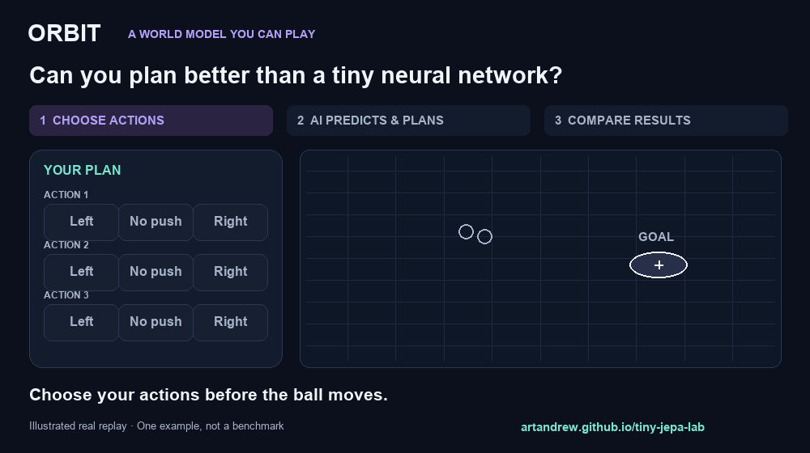

# ORBIT — демо модели мира, в которое можно сыграть

**Сможешь направить шарик к цели лучше маленькой нейросети?**

[**Играть →**](https://artandrew.github.io/tiny-jepa-lab/ru/) · [Play in English](https://artandrew.github.io/tiny-jepa-lab/) · [中文体验](https://artandrew.github.io/tiny-jepa-lab/zh/)

[English](README.md) · Русский · [简体中文](README.zh-CN.md)

ORBIT — **учебное демо модели мира в форме браузерной игры**. Маленькая нейросеть, вдохновлённая JEPA и обученная заранее, прогнозирует последствия действий и использует прогноз для планирования. Выбери три действия и сравни свой результат с её планом.

*Анимация построена по реальным правилам игры и выбору обученной модели. Это один пример, а не бенчмарк или запись экрана.*

## Что такое модель мира?

Модель мира учится по наблюдениям предсказывать, как изменится окружающая среда. Если прогноз учитывает действия, он помогает ответить **«Что случится, если я сделаю так?»** — до выбора плана.

В ORBIT весь «мир» намеренно маленький: **шарик, стены и цель**.

1. **Наблюдать:** превратить два изображения движущегося шарика в короткое числовое описание.
2. **Предсказать:** оценить последствия 27 возможных планов из трёх действий в пространстве признаков.
3. **Выбрать и проверить:** взять план, чей прогноз ближе к изображению цели, затем увидеть фактическое движение в симуляторе.

Модель не рисует будущие видеокадры. Она может ошибаться — ради наблюдения за этими ошибками и стоит попробовать демо. Это авторская учебная реализация по мотивам JEPA, с собственными весами и узкой задачей; модель Meta V-JEPA здесь не запускается.

## Как играть

Для каждого из трёх действий выбери **«Влево»**, **«Без толчка»** или **«Вправо»**, затем запусти план. В испытании дня пять раундов: чем ближе шарик к цели, тем больше очков. В свободной лаборатории можно менять планы и добавлять помехи на изображение.

- Нейросеть работает в браузере. Для игры не нужны регистрация и внешний AI-сервис.
- Русский, английский и китайский языки; светлая, тёмная и автоматическая темы.
- Карточка результата и ссылка на те же дневные сцены для вызова другу.
- Общий рейтинг — по желанию: после пяти раундов открой подготовленную форму GitHub и нажми **Create**. Логин и действия станут публичными, а очки будут пересчитаны автоматически. Аккаунт GitHub нужен только для этого шага.

За день учитывается лучший принятый результат аккаунта. Чтобы убрать попытку, закрой соответствующую заявку на GitHub. Проверяются очки; использование подсказок или автоматической игры не определяется.

## Помочь проекту

Непонятно управление или нашёл интересный промах модели? [Сообщи об ошибке](https://github.com/ArtAndrew/tiny-jepa-lab/issues/new), указав день, раунд и выбранные действия. Пригодятся скриншоты и улучшения переводов.

[Для разработчиков](DEVELOPMENT.md) · [Исходный отчёт об эксперименте](materials/ORBIT_RELEASE_REPORT_RU.md) · [Материалы для анонса](promotion/README.md)

Исходный notebook сохранён как учебный материал; дополнительные модули обучения в репозиторий не входят. Текущие ограничения воспроизводимости описаны в документации для разработчиков.

Автор: [Андрей Артищев](https://artishev.com) · [Лицензия MIT](LICENSE)
