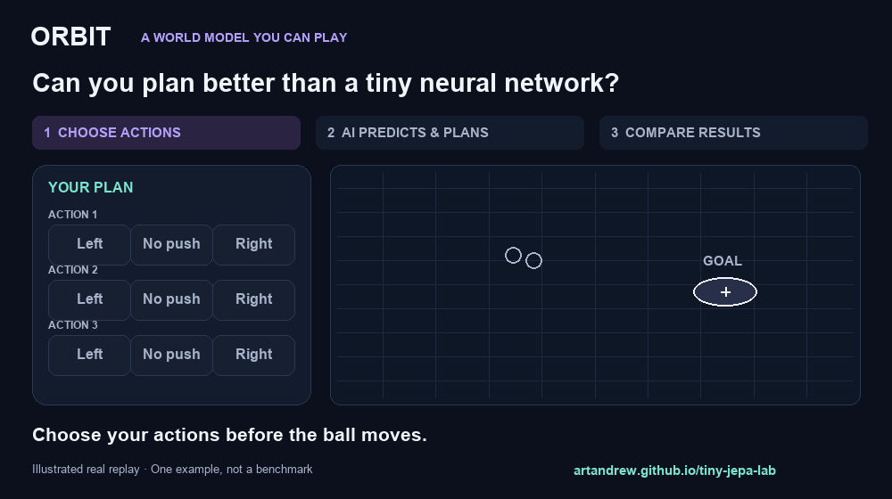

# ORBIT — 可以亲手体验的世界模型

**你能比小型神经网络更好地规划，让小球接近目标吗？**

[**开始体验 →**](https://artandrew.github.io/tiny-jepa-lab/zh/) · [Play in English](https://artandrew.github.io/tiny-jepa-lab/) · [Играть по-русски](https://artandrew.github.io/tiny-jepa-lab/ru/)

[English](README.md) · [Русский](README.ru.md) · 简体中文

ORBIT 是一个**以浏览器游戏呈现的世界模型教学演示**。一个提前训练好的、受 JEPA 启发的小型神经网络预测动作的结果，并利用预测进行规划。选择三个动作，将你的结果与它的计划进行比较。

[](https://artandrew.github.io/tiny-jepa-lab/zh/)

*动画根据真实游戏规则和已训练模型的选择生成。这是一个示例回合，并非基准测试或屏幕录制。*

## 什么是世界模型？

世界模型从观测中学习，预测环境将如何变化。如果预测考虑了动作，就可以在选择计划之前回答：**“如果这样做，会发生什么？”**

ORBIT 的“世界”刻意保持简单：**一个小球、墙壁和目标**。

1. **观察：**将运动中小球的两幅图像转换为紧凑的数值特征。
2. **预测：**在特征空间中预测 27 种三步动作计划的结果。
3. **选择并检验：**选择预测最接近目标图像的计划，再由模拟器展示实际运动。

预测器不会生成未来视频帧，也可能出错。观察它的错误正是这个演示的一部分。这是受 JEPA 启发的独立教学实现，有自己的训练权重，只处理一个很小的任务，并未运行 Meta 的 V-JEPA 模型。

<!-- glass-example:start -->
## 用水杯理解 LLM 与 JEPA 的区别

想象一个放在桌子边缘的水杯。如果把它推过桌边，会发生什么？这个例子可以帮助理解不同模型的训练任务。

<table>
<tr>
<td width="220"></td>
<td><strong>LLM：用语言解释</strong><p>根据对场景的描述，语言模型可能回答：“杯子会掉下去，水会洒出来，玻璃可能破碎。”</p><p>它利用从文本及其他训练数据中学到的规律。多模态模型还可以接收场景图像作为输入。</p></td>
</tr>
<tr>
<td width="220"></td>
<td><strong>JEPA：预测场景的内部表示</strong><p>这类模型从观测中学习，以数值特征的形式预测隐藏或未来的信息，也就是场景的内部描述。</p><p>如果模型经过额外训练，学会考虑动作，就可以利用预测，在执行之前评估不同推力可能造成的结果。</p></td>
</tr>
</table>

*照片用于说明水杯的例子，并非 ORBIT 的预测结果；ORBIT 只使用小球运动数据进行了训练。*

**这里的关键区别是训练目标。**

- 许多 LLM 在预训练阶段的主要任务是预测下一个词元，也就是一个词或词的一部分。
- JEPA 学习预测缺失信息的潜在表示；在动态模型中，也可以预测未来状态的表示。

LLM 同样可以给出正确解释，并在初始信息充分时帮助计算轨迹。JEPA 本身还不是完整的智能体，而是一种学习预测性表示的方法，可用于构建世界模型和规划系统。

ORBIT 用小球演示这个思路：模型观察两帧图像，预测 27 种计划的结果并选择其中一种，再由模拟器展示是否更接近目标。

原始资料： [I-JEPA：预测表示](https://ai.meta.com/blog/yann-lecun-ai-model-i-jepa/) · [V-JEPA 2：动作与规划](https://ai.meta.com/blog/v-jepa-2-world-model-benchmarks/) · [Llama 3：语言模型训练](https://arxiv.org/html/2407.21783v3#S2).
<!-- glass-example:end -->

## 如何游玩

为三个动作分别选择**向左、不推或向右**，再执行计划。每日挑战有五个回合，距离目标越近，得分越高。在自由实验室中，你可以尝试不同的计划，并为图像添加噪声。

- 模型在浏览器本地运行，游玩无需注册或调用外部 AI 服务。
- 支持俄语、英语和简体中文，以及浅色、深色和自动主题。
- 保存成绩卡片，邀请朋友挑战同一天的场景。
- 可选公开排行榜：完成五个回合后，打开填好的 GitHub 表单并点击 **Create**。用户名和动作将公开，分数会自动重新计算。只有这一步需要 GitHub 账号。

每个账号每天保留已接受成绩中的最高分。关闭对应的 GitHub Issue 可以撤回该次成绩。系统核对得分，不检测辅助或自动化游玩。

## 参与项目

操作不清楚，或者发现了有趣的模型失误？[创建 Issue](https://github.com/ArtAndrew/tiny-jepa-lab/issues/new)，注明日期、回合和所选动作。也欢迎截图和翻译改进。

[开发指南（俄语）](DEVELOPMENT.md) · [原始实验报告（俄语）](materials/ORBIT_RELEASE_REPORT_RU.md) · [发布材料](promotion/README.md)

## 运行与复现实验

[**可运行的 notebook**](materials/ORBIT_Action_Planning.ipynb) · [**独立权重**](artifacts/action_jepa/) · [**评测报告**](BENCHMARK.md) · [**训练指南**](REPRODUCIBILITY.md) · [模型说明](MODEL_CARD.md)

v0.4 提供经过核对的 Python 实现、每种条件 3,072 个场景的新评测，以及三次完整的动作预测器训练。浏览器仍使用原始模型。编码器原始预训练过程尚不可复现；新方案在固定编码器之上训练动作预测器。

[查看三个真实的模型错误 →](https://artandrew.github.io/tiny-jepa-lab/zh/#failures)

```sh
# Python 3.12，在仓库根目录运行
python -m pip install -r requirements-notebook.txt
python scripts/execute_notebook.py
python -m planning.benchmark --out reports/my-benchmark.json
```

隔离环境、PyTorch 安装和重新训练命令见训练指南。原始 notebook 保存在 `materials/archive/`。

作者：[Andrey Artishchev](https://artishev.com) · [MIT 许可证](LICENSE)
